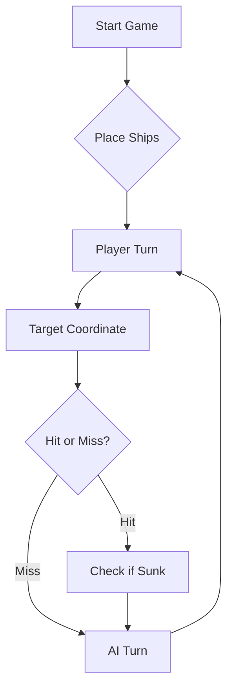

# ⚓ Battleship 2.0


> A modern take on the classic naval warfare game, designed for the XVII century setting with updated software engineering patterns.

---

## 📖 Table of Contents
- [Project Overview](#-project-overview)
- [Key Features](#-key-features)
- [Technical Stack](#-technical-stack)
- [Installation & Setup](#-installation--setup)
- [Code Architecture](#-code-architecture)
- [Roadmap](#-roadmap)
- [Testing & Continuous Integration](#-testing--continuous-integration)
- [Contributing](#-contributing)

---

## 🎯 Project Overview
This project serves as a template and reference for students learning **Object-Oriented Programming (OOP)** and **Software Quality**. It simulates a battleship environment where players must strategically place ships and sink the enemy fleet.

### 🎮 The Rules
The game is played on a grid (typically 10x10). The coordinate system is defined as:

$$(x, y) \in \{0, \dots, 9\} \times \{0, \dots, 9\}$$

Hits are calculated based on the intersection of the shot vector and the ship's bounding box.

---

## ✨ Key Features
| Feature | Description | Status |
| :--- | :--- | :---: |
| **Grid System** | Flexible $N \times N$ board generation. | ✅ |
| **Ship Varieties** | Galleons, Frigates, and Brigantines (XVII Century theme). | ✅ |
| **AI Opponent** | Heuristic-based targeting system. | 🚧 |
| **Network Play** | REST API multiplayer server. | ✅ |

---

## 🛠 Technical Stack
- **Language:** Java 25
- **Build Tool:** Maven
- **Testing:** JUnit 5/6
- **Logging:** Log4j2

---

## 🚀 Installation & Setup

### Prerequisites
- JDK 25 or higher
- Git

### Step-by-Step
1. **Clone the repository:**
   ```bash
   git clone [https://github.com/LEI-110582/Battleship2.git](https://github.com/LEI-110582/Battleship2.git)

```

2. **Navigate to directory:**
```bash
cd Battleship2

```


3. **Compile and Run:**
```bash
mvn compile exec:java -Dexec.mainClass="battleship.Main"

```


---

## 📚 Documentation

You can access the generated Javadoc here:

👉 [Battleship2 API Documentation](https://britoeabreu.github.io/Battleship2/)

### Core Logic

```java
public class Ship {
    private String name;
    private int size;
    private boolean isSunk;

    public void hit() {
        // Implementation here
    }
}

```

### Design Patterns Used:

* **Strategy Pattern:** For different AI difficulty levels (`AiShotStrategy`).
* **Observer / Callback Pattern:** To notify clients of game events (`CallbackClient`).

### Logic Flow



---

## 🗺 Roadmap

* [x] Basic grid implementation
* [x] Ship placement validation
* [x] REST Multiplayer Integration
* [ ] Add sound effects (SFX)
* [ ] Implement "Fog of War" mechanic

---

## 🧪 Testing & Continuous Integration

We use high-coverage unit testing (JUnit) to ensure game stability and prevent regressions during refactoring. Run tests locally using:

```bash
mvn test

```

> [!TIP]
> Use the `-Dtest=ClassName` flag to run specific test suites during development.

### Continuous Integration (GitHub Actions)

This repository uses the **Java CI with Maven** workflow (`.github/workflows/maven.yml`), which automatically builds the project with JDK 25 and runs the full JUnit test suite (`mvn -B test --file pom.xml`) on every `push` and `pull_request` to `main`.

---

## 🤝 Contributing

Contributions are what make the open-source community such an amazing place to learn, inspire, and create.

1. Fork the Project
2. Create your Feature Branch (`git checkout -b feature/AmazingFeature`)
3. Commit your Changes (`git commit -m 'Add some AmazingFeature'`)
4. Push to the Branch (`git push origin feature/AmazingFeature`)
5. Open a **Pull Request**

---

## 📄 License

Distributed under the MIT License. See `LICENSE` for more information.

---

**Maintained by:** [@LEI-110582](https://www.google.com/search?q=https://github.com/LEI-110582)

*Created for the Software Engineering students at ISCTE-IUL.*

```
